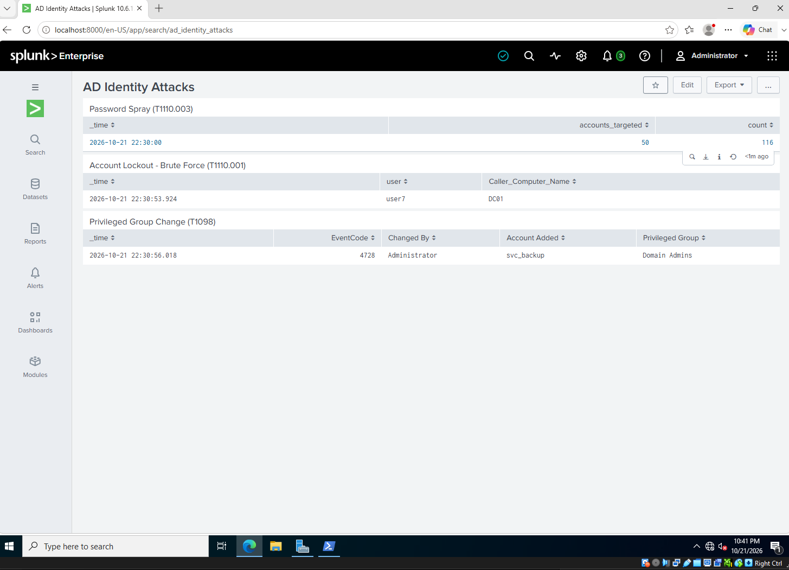
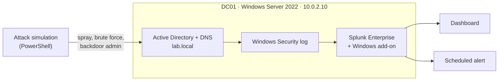
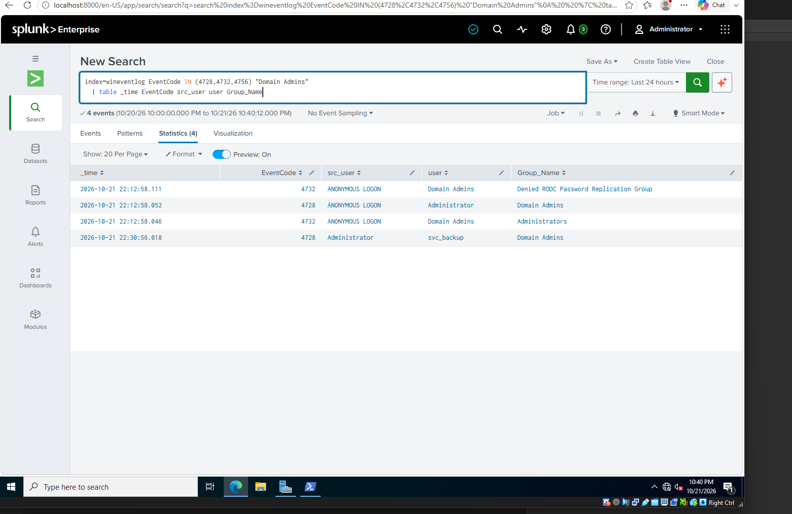
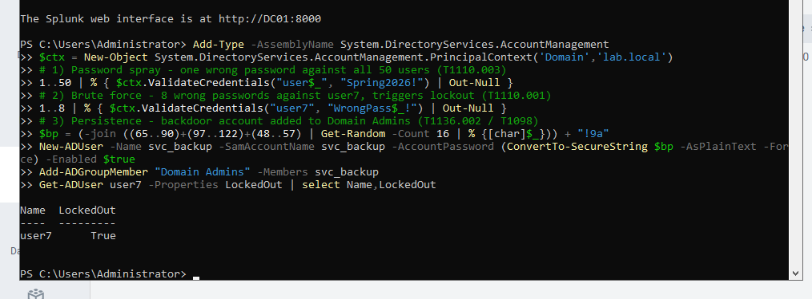
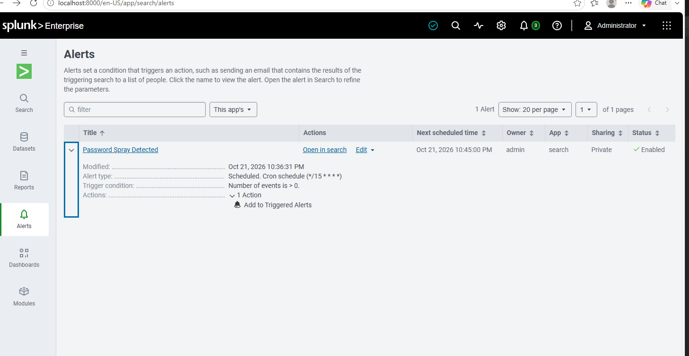

# AD Identity Attack Detection Lab

For this lab I built a small Active Directory environment at home, sent its security logs to Splunk, and then sent attacks to it to catch and log them. This repo includes all the scripts, the simulation, the splunk config, and the detections.

The goal was to learn splunk and gain hands on experience with splunk and also scripts to send attacks. I am interested in SOC so this was a no brainer. I wanted to map it to the MITRE ATT&CK framework.



## What I ended up detecting

| Attack | MITRE ATT&CK | Event IDs | What Splunk showed |
|---|---|---|---|
| Password spray | [T1110.003](https://attack.mitre.org/techniques/T1110/003/) | 4771, 4776, 4625 | 50 accounts hit with 116 failed logins in a single 5-minute window |
| Brute force | [T1110.001](https://attack.mitre.org/techniques/T1110/001/) | 4740 | `user7` locked out after 5 bad passwords |
| Backdoor admin account | [T1136.002](https://attack.mitre.org/techniques/T1136/002/), [T1098](https://attack.mitre.org/techniques/T1098/) | 4720, 4728 | `svc_backup` created and added to Domain Admins |

I also set up the password spray search as a scheduled alert that runs every 15 minutes. It fired on its own after the attack, which was the moment the whole thing felt like a real SOC workflow and not just me running searches.

## The setup

Everything runs on one Windows Server 2022 VM in VirtualBox. It's the domain controller and the Splunk server at the same time, which saved a lot of RAM and setup time.



- **Domain:** `lab.local` with 50 users spread across five department OUs (IT, HR, Sales, Finance, Marketing), each with its own security group
- **Policy:** accounts lock after 5 failed attempts for 15 minutes, and I turned on advanced auditing for logons, Kerberos, lockouts, and user/group changes
- **Splunk:** Splunk Enterprise 10.6 with the Splunk Add-on for Microsoft Windows, collecting the Security log into its own `wineventlog` index
- **Network:** a VirtualBox NAT network (10.0.2.0/24)

## How I built it

The scripts in [`scripts/`](scripts/) are numbered in the order I ran them:

1. `01-network-and-adds.ps1`: static IP, time zone, install the AD DS role, rename the server
2. `02-create-forest.ps1`: promote the server to a domain controller for `lab.local`
3. `03-create-users.ps1`: build the OUs and groups and create 50 users, each with a random password
4. `04-lockout-and-audit-policy.ps1`: lockout policy and audit settings
5. `05-install-splunk.ps1`: silent Splunk install from a read-only shared folder
6. `06-configure-splunk.ps1`: install the Windows add-on, create the index, start collecting the Security log
7. `07-attack-simulation.ps1`: the three attacks
8. `99-reset-lab.ps1`: unlocks `user7` and removes the backdoor account so I can run it again

I configured Splunk by writing the `.conf` files directly instead of clicking through the web UI. Those files are in [`splunk/lab_inputs/local/`](splunk/lab_inputs/local/). The dashboard is in [`splunk/dashboards/`](splunk/dashboards/) if you want to import it.

## The detections

### Password spray
[`detections/01_password_spray.spl`](detections/01_password_spray.spl)

```spl
index=wineventlog EventCode IN (4771,4776,4625)
| search NOT (EventCode=4776 Error_Code="0x0")
| eval acct=coalesce(user, Logon_Account, Account_Name)
| bin _time span=5m
| stats dc(acct) AS accounts_targeted count BY _time
| where accounts_targeted >= 10
```

A spray tries one password against a lot of accounts, so no single account gets enough failures to lock out. Counting failures per account would miss it. Instead, this counts how many *different* accounts failed in each 5-minute window. Ten or more is suspicious. My test hit 50.

### Brute force
[`detections/02_account_lockout.spl`](detections/02_account_lockout.spl)

```spl
index=wineventlog EventCode=4740
| table _time user Caller_Computer_Name
```

This one is simple. Event 4740 only gets written when an account hits the lockout threshold, so seeing it tells me someone was hammering one account, and that the lockout policy actually worked.

### Backdoor admin
[`detections/03_privileged_group_change.spl`](detections/03_privileged_group_change.spl)

```spl
index=wineventlog EventCode IN (4728,4732,4756)
    Group_Name IN ("Domain Admins","Enterprise Admins","Administrators","Schema Admins")
    src_user!="ANONYMOUS LOGON"
| table _time EventCode src_user user Group_Name
| rename src_user AS "Changed By", user AS "Account Added", Group_Name AS "Privileged Group"
```

My first version of this search just looked for "Domain Admins" and came back with four results instead of one. Three of them were from Windows itself setting up its default groups when I created the domain. They showed up as `ANONYMOUS LOGON` nesting built-in groups inside each other. I narrowed the search to changes *to* privileged groups and filtered out that system activity, and it went down to just the real attack.

<details>
<summary>Before tuning (3 false positives)</summary>


</details>

## Running the attacks



And the alert firing on its own afterward:



## Things that tripped me up

- **Windows doesn't log most failed logins by default.** Without turning on auditing for credential validation and Kerberos authentication first, the spray and brute force would have barely shown up in Splunk. Getting the logging right mattered as much as writing the searches.
- **The same field has different names in different events.** The account name is `Account_Name` in 4771 but `Logon_Account` in 4776, so the spray search uses `coalesce()` to merge them into one field.
- **Detections need tuning.** The backdoor admin search above is the best example. Writing a search that finds the attack is the easy part. Getting it to *only* find the attack takes more work.
- **VirtualBox fought me a little.** The VM crashed once during a reboot (fixed by setting the boot order to the hard disk and ejecting the Guest Additions ISO), and at one point the keyboard stopped reaching the VM until I restarted Windows inside it.

## What I want to add next

- A Windows 11 client joined to the domain, so attacks come from a separate machine like they would in real life
- Sysmon for process-level logging
- Kerberoasting (T1558.003) and a detection for weak RC4 service ticket requests
- Moving the audit settings into a proper Group Policy Object instead of `auditpol`
- Hardening the domain and showing the same attacks failing

---

Everything here ran in an isolated virtual lab.
